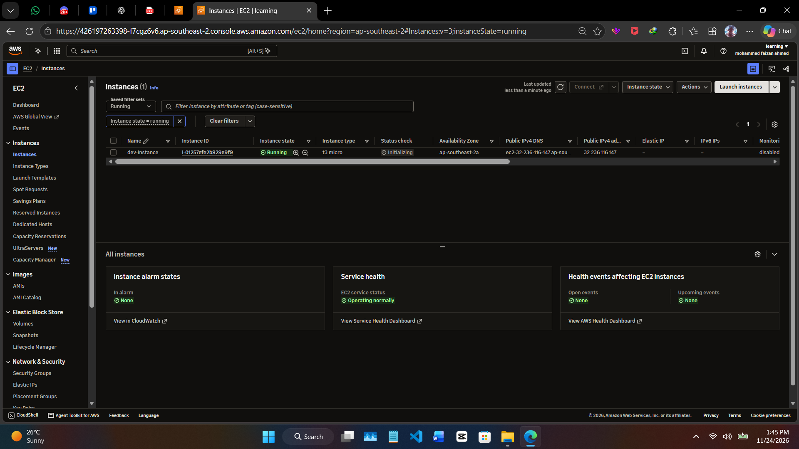
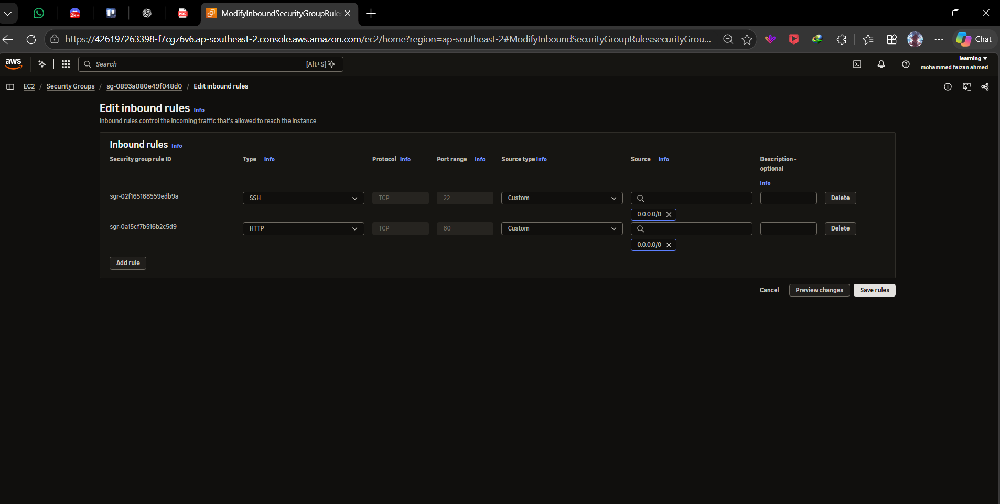
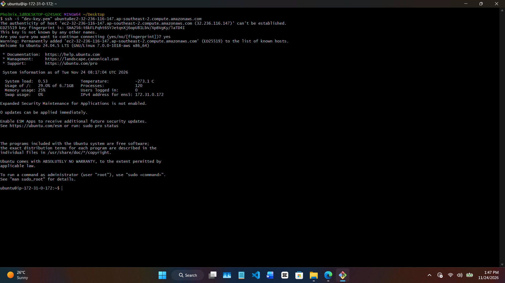
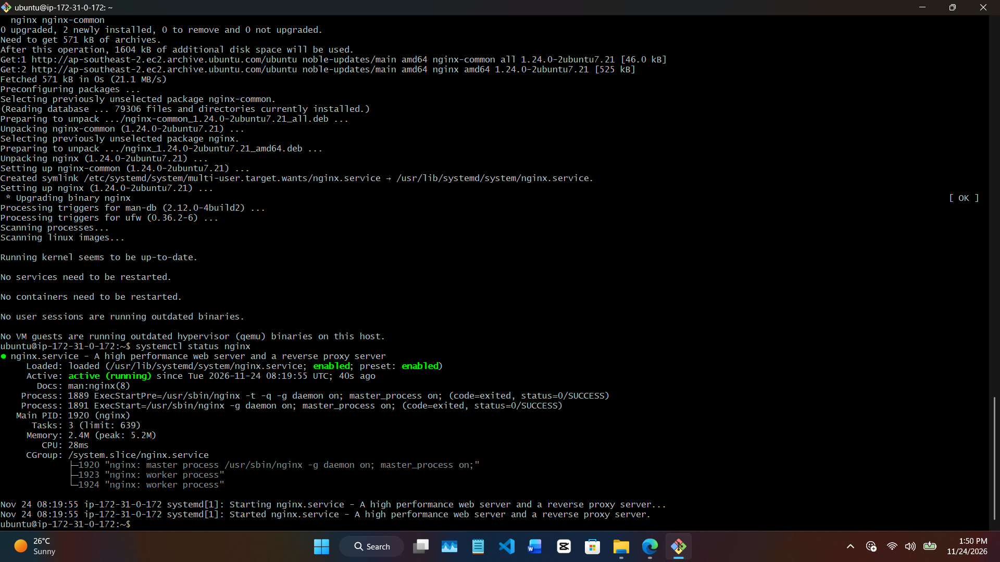
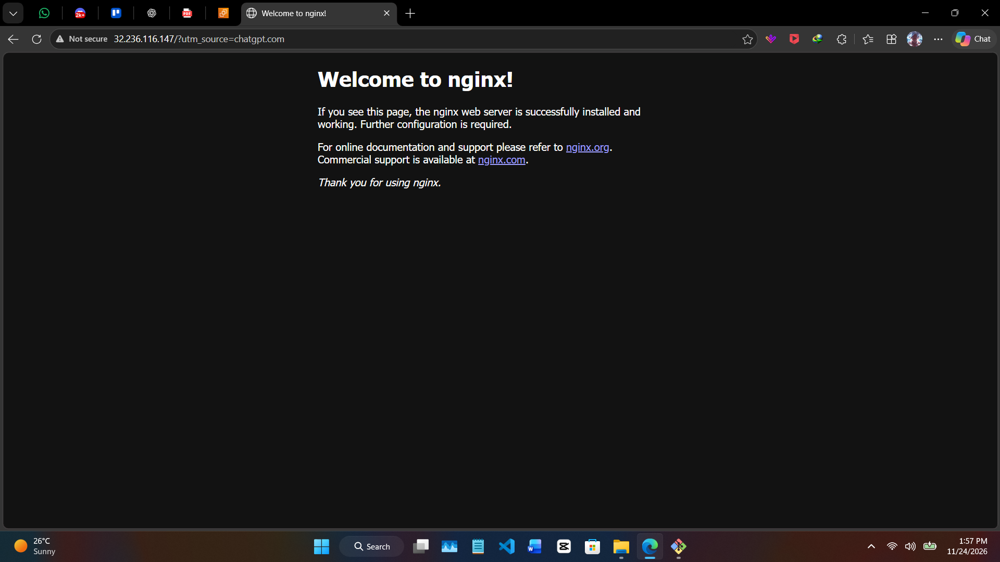
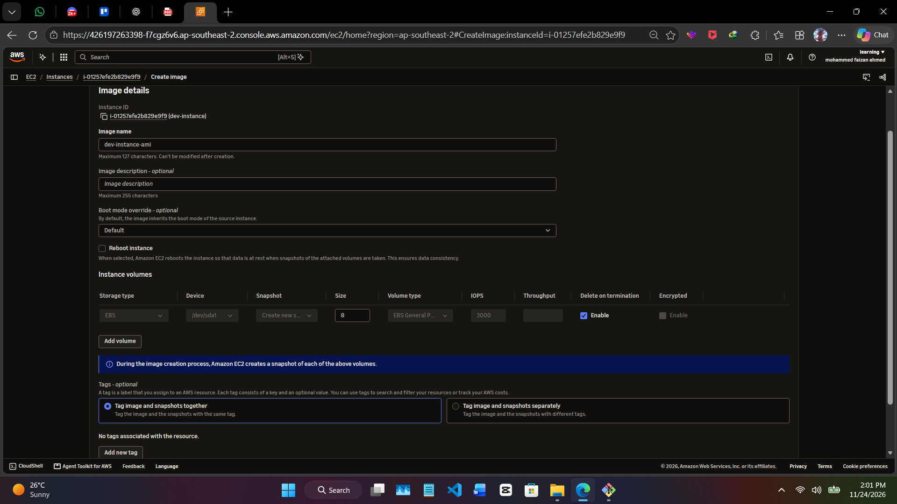
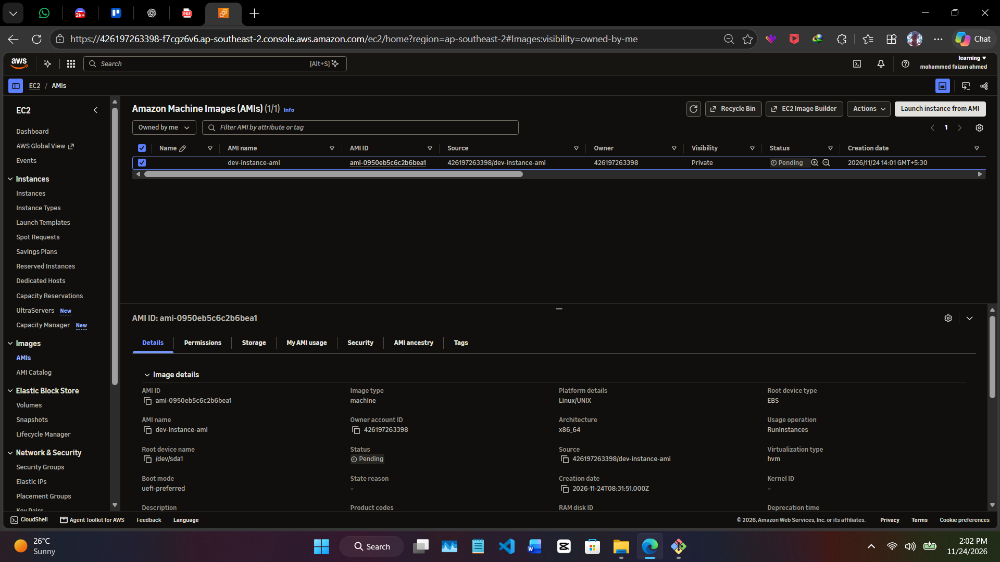

# Week 2 -- Task 1: AWS Cloud Setup Using EC2

## 1. Task Overview

This task demonstrates how to launch and configure an Amazon EC2
virtual machine, connect to it using SSH, install and configure the
Nginx web server, and make a basic website accessible over the internet.

The implementation was carried out using the **AWS Learning Console**,
which provides a restricted AWS environment with limited instance
availability and configuration options. Although the original assignment
recommended **Ubuntu 22.04 LTS with a `t2.micro` instance**, this
implementation used **Ubuntu 24.04 LTS with a `t3.micro` instance**
because the recommended `t2.micro` instance type was unavailable in the
provided learning environment. Ubuntu 24.04 LTS and `t3.micro` were
selected from the options available in the learning console.

## 2. Objectives

-   Launch and configure an Amazon EC2 instance.
-   Understand EC2 instance configuration and networking.
-   Configure security groups for SSH and HTTP access.
-   Connect to an Ubuntu server using SSH and an EC2 key pair.
-   Install and configure the Nginx web server.
-   Access the web server through the instance's public IPv4 address.
-   Create an Amazon Machine Image (AMI) of the configured instance.

## 3. AWS Environment and Configuration

  Component         |  Configuration
  -------------------| ---------------------------
  Cloud provider      |Amazon Web Services (AWS)
  Environment        | AWS Learning Console
  Service             |Amazon EC2
  Operating system   | Ubuntu Server 24.04 LTS
  Instance type      |`t3.micro`
  Web server         | Nginx
  Connection method  | SSH
  Authentication     | EC2 key pair (`.pem`)
  SSH port           | TCP 22
  HTTP port          | TCP 80
  Website access    |  Public IPv4 address

## 4. Implementation

### Step 1: Access the AWS Learning Console

1.  Logged in to the AWS Learning Console.
2.  Opened the AWS Management Console.
3.  Navigated to the Amazon EC2 service 

### Step 2: Launch an EC2 Instance

1.  Selected **Launch instance**.
2.  Entered a name for the instance.
3.  Selected **Ubuntu Server 24.04 LTS**.
4.  Selected the `t3.micro` instance type.
5.  Created a new key pair and downloaded the private `dev-key.pem` file.
6.  Configured the network and security settings.
7.  Reviewed the configuration and launched the instance.

   

### Step 3: Configure the Security Group

Configured inbound rules to allow SSH and HTTP traffic:

  Type   Protocol     Port Source        Purpose
  ------ ---------- ------ ------------- ----------------------
  SSH    TCP            22 `0.0.0.0/0`   Remote server access
  HTTP   TCP            80 `0.0.0.0/0`   Public web access

  

**Security note:** SSH was configured with `0.0.0.0/0` during this
learning exercise. For a production environment, restrict SSH access to
a trusted IP address or range. HTTP is open to the internet so that
visitors can access the web server.

### Step 4: Connect to EC2 Using SSH

From a terminal, connected to the Ubuntu instance using the downloaded
key pair:

``` bash
ssh -i "dev-key.pem" ubuntu@ec2-32-236-116-147.ap-southeast-2.compute.amazonaws.com
```
  

After successful authentication, the Ubuntu terminal was accessible
remotely.

### Step 5: Update Ubuntu Packages

Updated the package repository and installed available system updates:

``` bash
sudo apt update
sudo apt upgrade -y
```

### Step 6: Install Nginx

Installed the Nginx web server:

``` bash
sudo apt install nginx -y
```

### Step 7: Start, Enable, and Verify Nginx

Started Nginx and enabled it to start automatically when the instance
boots:

``` bash
sudo systemctl start nginx
sudo systemctl enable nginx
```

Checked the service status:

``` bash
sudo systemctl status nginx
```

   

The service status showed **`active (running)`**, confirming that Nginx
was running.


### Step 8: Access the Website Using the Public IPv4 Address

Copied the EC2 instance's public IPv4 address from the EC2 dashboard and
opened it in a browser:

``` text
http://32-236-116-147
```

    

The default **Welcome to nginx!** page confirmed that the web server was
accessible through the instance's public IPv4 address.

**Note:** This deployment uses HTTP. HTTPS/SSL/TLS was not configured as
part of this basic task. Use `http://` when testing the site.

### Step 9: Create an AMI

Created an Amazon Machine Image (AMI) of the configured EC2 instance:

1.  Opened **EC2 → Instances**.
2.  Selected the configured Ubuntu instance.
3.  Chose **Actions → Image and templates → Create image**.
4.  Entered an AMI name and description.
5.  Submitted the image creation request.

  
 
### Step 10: Verify the AMI

Opened the **AMIs** section in the EC2 console and verified that the
created image was listed.

  


## 5. Project Outcome

Successfully configured an Ubuntu 24.04 LTS EC2 instance using the
`t3.micro` instance type in the AWS Learning Console. Installed and
configured Nginx, verified that its service was running, configured the
security group rules for SSH and HTTP, accessed the default Nginx page
through the public IPv4 address, and created and verified an AMI.

This exercise provided hands-on experience with EC2 provisioning, Linux
administration, SSH connectivity, AWS security groups, web server
deployment, and AMI creation.

## 6. Conclusion

This task provided practical experience in deploying and managing a
Linux-based virtual machine on AWS and hosting a basic web server using
Nginx.

The original assignment specified Ubuntu 22.04 LTS and `t2.micro`. Due
to the instance availability and configuration limitations of the AWS
Learning Console, Ubuntu 24.04 LTS and `t3.micro` were used instead. The
alternative configuration enabled completion of the EC2 setup and web
server deployment within the available learning environment.

## 7. Technologies Used

-   Amazon Web Services (AWS)
-   Amazon EC2
-   AWS Learning Console
-   Ubuntu Server 24.04 LTS
-   `t3.micro`
-   Nginx
-   Linux
-   SSH
-   AWS Security Groups
-   Amazon Machine Image (AMI)
